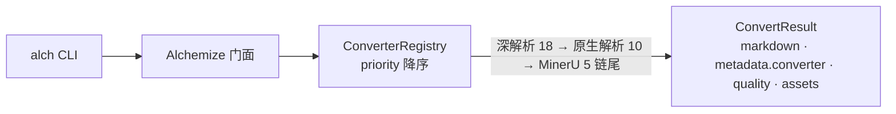

<div align="center">


[](https://www.rust-lang.org/) [](https://www.rust-lang.org/) [](LICENSE)

**中文** | [English](README_EN.md)

**把任意文档炼成 Markdown**

[✨ 功能特性](#-功能特性) • [🚀 快速开始](#-快速开始) • [📚 文档](#-文档) • [💻 示例](#-示例) • [🤝 参与贡献](#-参与贡献)

</div>

---

<div align="center">

### 🎯 一处输入，任意格式，炼成 Markdown

给 `alch` 一个文件——PDF、Office、音视频、zip 压缩包——它按优先级 fallback 链自动选引擎，产出带质量标注的 Markdown：

<table style="width:100%; border-collapse: collapse">
<tr>
<td align="center" width="25%">🧪<br><b>任意格式</b><br><span style="color:#64748B">文档 · 代码 · 图片 · 音视频 · 字幕 · zip</span></td>
<td align="center" width="25%">🔗<br><b>fallback 链</b><br><span style="color:#64748B">priority 降序 · 失败自动降级 · 降级显性</span></td>
<td align="center" width="25%">🏷️<br><b>质量分层</b><br><span style="color:#64748B">api / local_full / local_fallback · 引擎可溯</span></td>
<td align="center" width="25%">🏠<br><b>本地优先</b><br><span style="color:#64748B">默认零外部服务 · --no-remote 全离线</span></td>
</tr>
</table>

</div>

---

## 📋 目录

<details open>
<summary>📑 目录</summary>

- [✨ 功能特性](#-功能特性)
- [🚀 快速开始](#-快速开始)
- [🎨 特性标志](#-特性标志)
- [📚 文档](#-文档)
- [💻 示例](#-示例)
- [🏗️ 架构](#️-架构)
- [🧪 测试](#-测试)
- [📊 性能](#-性能)
- [🔒 安全](#-安全)
- [🗺️ 开发路线图](#️-开发路线图)
- [🤝 参与贡献](#-参与贡献)
- [📋 更新日志](#-更新日志)
- [📄 许可证](#-许可证)
- [🙏 致谢](#-致谢)
- [📞 联系与支持](#-联系与支持)
- [⭐ Star 历史](#-star-历史)

</details>

---

## ✨ 功能特性

<table style="width:100%; border-collapse: collapse">
<tr>
<td width="50%" style="vertical-align:top; padding: 12px">📄 <b>文档全格式</b><br><span style="color:#64748B">PDF（pdfium/纯 Rust/MinerU）、docx/pptx、odt/odp、旧版二进制 Office（doc/ppt/rtf，LibreOffice）、html/epub、csv/tsv/psv、LaTeX/org/rst/asciidoc（pandoc）、ipynb</span></td>
<td width="50%" style="vertical-align:top; padding: 12px">🧬 <b>代码围栏化</b><br><span style="color:#64748B">py/rs/js/ts/go/java/c/cpp/json/yaml/toml/xml/sh 等 ~45 扩展名，带语言标签的围栏代码块</span></td>
</tr>
<tr>
<td width="50%" style="vertical-align:top; padding: 12px">🖼️ <b>图片处理</b><br><span style="color:#64748B">注入 VisionProvider 做描述与 OCR；不注入则降级为元数据 markdown（含尺寸/哈希）</span></td>
<td width="50%" style="vertical-align:top; padding: 12px">🎙️ <b>音视频转录</b><br><span style="color:#64748B">自研 vecboost 门面（Qwen3-ASR ONNX + silero VAD）完全本地推理；输出 VAD 段级文本 + 时间戳</span></td>
</tr>
<tr>
<td width="50%" style="vertical-align:top; padding: 12px">⏱️ <b>字幕解析</b><br><span style="color:#64748B">srt/vtt/ass/ssa 原生解析，输出时间码列表，不经 ffmpeg</span></td>
<td width="50%" style="vertical-align:top; padding: 12px">📦 <b>zip 递归</b><br><span style="color:#64748B">压缩包内文件按扩展名走各自引擎；嵌套 zip 显式不支持，无界自递归在结构上不可能</span></td>
</tr>
<tr>
<td width="50%" style="vertical-align:top; padding: 12px">🌐 <b>多编码探测</b><br><span style="color:#64748B">UTF-8 直读 → GBK/Big5/Shift-JIS 等 CJK 优先探测 → lossy 兜底；csv 分隔符自探测</span></td>
<td width="50%" style="vertical-align:top; padding: 12px">🧭 <b>引擎偏好与诊断</b><br><span style="color:#64748B"><code>--engine</code> 精确名优先、前缀回退（未命中静默回落）；<code>doctor</code> 逐引擎可用性、<code>formats</code> 全格式清单</span></td>
</tr>
<tr>
<td width="50%" style="vertical-align:top; padding: 12px">🖼 <b>资产双模式</b><br><span style="color:#64748B"><code>dir</code>（图片写 <code>images/</code> 相对引用）与 <code>inline</code>（base64 单文件交付）</span></td>
<td width="50%" style="vertical-align:top; padding: 12px">🛡️ <b>安全防线</b><br><span style="color:#64748B">MinerU URL SSRF 校验（HTTPS-only/私网拒绝/域名白名单）、响应分級限量、凭据三通路脱敏</span></td>
</tr>
<tr>
<td width="50%" style="vertical-align:top; padding: 12px">☁️ <b>MinerU 云端高保真</b><br><span style="color:#64748B">Agent/Precision 双客户端按文件大小选择、轮询退避；本地优先、云端兜底（链尾）</span></td>
<td width="50%" style="vertical-align:top; padding: 12px">🧰 <b>CLI 诊断三件套</b><br><span style="color:#64748B"><code>convert</code>（-o/--engine/--assets/--no-remote/--format）、<code>doctor</code>、<code>formats</code>；退出码 0/1/2/3 语义化</span></td>
</tr>
</table>

除上述核心能力外，视频抽轨与帧去重、视频处理模式（Gpu/AudioOnly/Disabled）、Whisper 兼容云端后端（显式注入激活）、LaTeX 数学定界符校验等能力也均已内置或以独立特性标志提供；完整矩阵见 [🎨 特性标志](#-特性标志) 一节。

---

## 🚀 快速开始

### 📦 安装

```bash
# 检查 Rust 版本（要求 1.97.1+）
rustc --version

# 默认特性构建（零外部服务依赖）
cargo build --release          # 二进制：target/release/alch

# 全功能（MinerU 云端 + 自研 office 深解析 + 容器/数据/邮件 + LibreOffice + 本地 ASR）
cargo build --release --features full

# 安装到本地
cargo install --path . --features full
```

### 💡 最小示例

```bash
# 转换到 stdout
alch convert paper.pdf

# 写文件 + 引擎偏好 + 资产模式（父目录自动创建）
alch convert report.docx -o report.md --engine docx-deep --assets dir|inline

# stderr 摘要行：质量层级与实际引擎一目了然
# converted report.docx -> report.md [local_full] (engine: docx-deep)
```

```bash
# 引擎诊断 / 支持格式
alch doctor
alch formats
```

退出码：`0` 成功（含降级产出）；`1` 其他错误；`2` 不支持格式；`3` 全链失败（stderr 列出各引擎失败原因）。

### 📊 支持格式矩阵

| 类别 | 扩展名 | 引擎（priority） | 需要的 feature |
| --- | --- | --- | --- |
| Word（OOXML） | docx | docx-deep(18) → docx(10) | — |
| Word（旧版） | doc, rtf | legacy-office(15，LibreOffice) | `libreoffice` |
| OpenDocument 文本 | odt | odt-deep(18) | — |
| 演示文稿 | pptx / ppt,pps,pot / odp | pptx-deep(18) → pptx(10) / legacy-ppt(15) / odp-deep(18) | `libreoffice`（仅旧二进制） |
| 电子表格 | —（不支持） | 表格解析器已移除：calamine 的物化面（共享字符串、styles/theme、ODS 重复与文本展开）无法在不可信输入上被前置校验约束；xlsx/xls/xlsb/ods 不再支持 | — |
| PDF | pdf | pdfium(20) → pdf-extract(10) → MinerU(5) | `pdfium` / `mineru` |
| 网页 / 电子书 | html, htm / epub | html(htmd) → html-deep(15) / epub | `html-deep`（html-deep） |
| 纯文本 / 代码 | txt, md, log, jsonl, ndjson, env, properties, rmd, qmd, mmd + ~45 代码扩展 | text（围栏化） | — |
| 表格文本 | csv, tsv, psv | csv（分隔符自探测） | — |
| 标记语言 | tex, latex / org, rst, adoc, asciidoc, opml, mediawiki, wiki, textile | latex-source / pandoc-generic | — |
| 笔记本 | ipynb | ipynb | — |
| 图片 | png, jpg, jpeg, gif, webp, bmp, tif, tiff, svg / heic, heif | image（Vision 可选） / heic（sips 或元数据） | — |
| 音频 | wav, mp3, ogg, opus, flac, aac, m4a, wma | audio（ASR 可选） | `asr` |
| 视频 | mp4, m4v, mov, avi, mkv, webm, flv, wmv | video（ffmpeg + ASR/Vision 可选） | `asr`（转录） |
| 字幕 | srt, vtt, ass, ssa, lrc | subtitle | — |
| 邮件 | eml | eml | `eml` |
| 结构化数据 | parquet / sqlite, db, sqlite3 / bib | parquet / sqlite / bib | `data` |
| 归档 | zip, cbz / tar, tgz / gz, xz, zst / 7z | zip 递归 / tar 族递归 / 7z 递归 | `containers`（除 zip） |

### 🧭 核心概念

- **注册表与 fallback 链**：同扩展名的引擎按 `priority()` 降序尝试，前序失败自动降级，`Unavailable` 引擎跳过并记录原因。
- **质量分层**：每次产出标注 `api`（云端高保真）/ `local_full`（本地全功能）/ `local_fallback`（本地降级），与实际引擎名一起记录在 `metadata` 与 stderr 摘要行。
- **本地优先**：PDF 链为 pdfium(20，可选 feature) → pdf-extract(10) → MinerU(5 链尾，配置端点后)——云端只在本地链失败后兜底。

---

## 🎨 特性标志

### 📦 功能预设

| 预设 | 命令 | 适用场景 |
| --- | --- | --- |
| 最小化 | `cargo build` | 纯本地转换，零外部服务依赖 |
| 推荐 | `cargo build --features containers,data,eml,libreoffice` | + 归档/结构化数据/邮件/旧版 Office（soffice 存在时生效） |
| 生产 | `cargo build --features full` | + MinerU 云端 PDF + 本地 ASR + html-deep |

### 📋 功能矩阵

| feature | 引入 | 说明 |
| --- | --- | --- |
| `mineru` | MinerU 云端 PDF 引擎（reqwest/limiteron） | 端点经 `ALCHEMIZE_MINERU_URL` 配置后才注册 |
| `pdfium` | 本地 PDF 高保真引擎（pdfium-render） | 运行时探测动态库；缺失降级到 pdf-extract。嵌入图提取走 lopdf 结构遍历（DCT/JPX 直通，样本重编码 PNG，不支持项显性计数） |
| `libreoffice` | 旧版二进制 Office 引擎（外部 soffice） | doc/rtf→docx、ppt/pps/pot→pptx 后进深解析链；缺席自动降级 |
| `containers` | 归档容器族（tar/tgz/gz/xz/zst/7z） | 递归转换，魔数检测内层格式 |
| `data` | 结构化数据引擎（parquet/sqlite/bib） | parquet 流式 10 万行截断、sqlite 只读、biblatex 条目 |
| `eml` | 邮件引擎（mail-parser） | 头部/正文/附件清单 |
| `asr` | vecboost 转录门面 + Whisper 兼容 API | Qwen3-ASR ONNX + silero VAD，path 依赖兄弟仓 vecboost |
| `mcp` | MCP 工具面（`alch-mcp` stdio 服务） | convert/doctor/formats 以 MCP 工具暴露；CLI 封装（sdforge）恒在 |
| `html-deep` | html-deep 自研引擎（迭代状态机 → htmd 兜底） | 主内容提取（`--extract-main`）与链接绝对化（`--base-url`）；含 LaTeX 数学的页面自动路由 htmd 保真 |
| `full` | 以上全部（`mineru`+`asr`+`html-deep`+`containers`+`data`+`eml`+`libreoffice`） | |

默认 `default = ["cli"]`（CLI 封装恒在）——feature 关闭的引擎根本不参与编译。

---

## 📚 文档

<details>
<summary>📋 表格</summary>

| 文档 | 说明 |
|------|------|
| [📖 用户指南](docs/USER_GUIDE.md) | 从安装到进阶的完整使用教程 |
| [📘 API 参考](docs/API_REFERENCE.md) | 全部公开 API、CLI 接口与环境变量 |
| [🏗️ 架构文档](docs/ARCHITECTURE.md) | 设计原则、模块划分与 fallback 链机制 |
| [❓ FAQ](docs/FAQ.md) | 常见问题解答 |
| [🔒 安全文档](docs/SECURITY.md) | 信任边界、SSRF 防护与漏洞报告 |
| [🤝 贡献指南](docs/CONTRIBUTING.md) | 开发环境、TDD 工作流与提交约定 |
| [📋 更新日志](docs/CHANGELOG.md) | 版本变更记录 |

</details>

能力域规格真源（转换/降级链/媒体/CLI 输出等可验证行为）在 `specmark/specs/`。

---

## 💻 示例

### 🤖 CLI 工具

```bash
# 管道友好：stdout 直出
alch convert paper.pdf | head -50

# 批量：shell 循环
for f in docs/*.docx; do alch convert "$f" -o "md/$(basename "${f%.docx}").md"; done

# 离线/合规环境：进程零网络出口
alch convert --no-remote secret.docx -o secret.md

# 不可信扩展名时强制指定格式
alch convert payload.bin --format pdf
```

### 🦀 作为库使用

```rust
use alchemize::{AlchemizeBuilder, Input};

#[tokio::main]
async fn main() -> Result<(), alchemize::AlchemizeError> {
    let alch = AlchemizeBuilder::new().build();
    let result = alch.convert(&Input::Path("paper.pdf".into())).await?;
    println!("engine: {}", result.metadata["converter"]);   // 实际引擎
    println!("quality: {}", result.quality);                // 质量层级
    println!("{}", result.markdown);
    Ok(())
}
```

更多示例（自定义视觉/转录提供方、资产模式、注册表装配）见 [API 参考 · 使用示例](docs/API_REFERENCE.md#-使用示例)。

---

## 🏗️ 架构

单 crate DDD 三层：`domain`（类型与规则，无网络/进程 IO）→ `application`（Converter 注册表 priority fallback 链 + 端口）→ `infrastructure`（各格式转换器 + MinerU/ASR 后端）。



设计原则、模块划分与数据流详见 [🏗️ 架构文档](docs/ARCHITECTURE.md)。

---

## 🧪 测试

### 🎯 测试策略

- **双档矩阵**：default 档（无外部服务依赖）与 `--features full` 档全量运行。
- **真实文件套件**：12 项真实文件测试硬断言，素材为 9 个仓库内 fixtures 与 1 个外部视频源，不止合成样例。
- **金样输出**：`tests/golden.rs` 钉住各格式转换产出的文本形态。
- **CLI e2e**：退出码、stderr 摘要、资产落盘全链路验证。

### ▶️ 运行命令

```bash
cargo test                    # default 档（317 例）
cargo test --features full    # full 档（396 例）
cargo clippy --all-features   # 零新增告警
cargo fmt --check             # 格式化零 diff
cargo llvm-cov --features full # 覆盖率（门禁 ≥90%）
```

### 📊 测试规模

| 档位 | 通过 | 失败 | 忽略 |
| --- | --- | --- | --- |
| default | 317 | 0 | 0 |
| full | 396 | 0 | 1（真模型端到端，待 ASR bundle） |

行覆盖率 **90.49%**（门禁 ≥90%）。

---

## 📊 性能

本仓暂无 criterion 基准数据，不提供性能数字（不编造）。设计层面的取舍：单线程 runtime、异步远端路径（limiteron 轮询退避）、无全局健康缓存（每次转换即时探测）、响应内存有界（分级限量、预分配上限 8MB）。设计要点见 [🏗️ 架构文档 · 性能设计](docs/ARCHITECTURE.md#-性能设计)；基准数据将在引入 criterion 后补充。

---

## 🔒 安全

### 🛡️ 安全设计

四道防线：不可信输入的结构化错误处理（不 panic）；MinerU 下载 URL 的 SSRF 校验（HTTPS-only、拒环回/RFC1918/CGNAT/链路本地、域名白名单、预签名）；远端响应按用途分级限量（64KB/8KB/50MB/50MB）；凭据来自环境变量或 `MineruConfig::api_token`，三通路脱敏。详见 [🔒 安全文档](docs/SECURITY.md)。

### ⛓️ 供应链与门禁

`Cargo.lock` 入库锁定依赖图；全部源文件带 `SPDX-License-Identifier: Apache-2.0` 头（59/59，license 扫描工具可机器识别）；`cargo audit` 纳入升级流程，已知可接受风险在[安全文档](docs/SECURITY.md#已知且可接受的风险)登记。

### 🚨 报告安全漏洞

**不要**开公开 Issue。使用 GitHub 私密安全通告（**Security → Report a vulnerability**），流程与响应承诺见[安全文档 · 漏洞报告流程](docs/SECURITY.md#-漏洞报告流程)。

---

## 🗺️ 开发路线图

<details>
<summary>📋 表格</summary>

<table style="width:100%; border-collapse: collapse">
<tr><th style="text-align:center">状态</th><th style="text-align:left">方向</th><th style="text-align:left">条目</th></tr>
<tr><td align="center">✅</td><td>转换引擎</td><td>注册表 fallback 链、文档全格式、代码围栏化、zip 递归、多编码探测</td></tr>
<tr><td align="center">✅</td><td>可选后端</td><td>自研 office 深解析（docx/odt/odp/pptx）、MinerU 云端 PDF（SSRF 防护 + 限量）、vecboost 本地 ASR</td></tr>
<tr><td align="center">✅</td><td>媒体链路</td><td>图片视觉端口、ffmpeg 抽轨、字幕原生解析、帧去重、VAD 段级转录</td></tr>
<tr><td align="center">✅</td><td>CLI 与诊断</td><td>sdforge 封装（CLI+MCP 双面）、convert/doctor/formats、退出码语义化、引擎偏好与资产模式</td></tr>
<tr><td align="center">✅</td><td>文档与合规</td><td>七篇文档套件（结构对齐 confers）、双语 README、SPDX 版权头 59/59、覆盖率 90.49%</td></tr>
<tr><td align="center">✅</td><td>供应链收口</td><td>anydoc 依赖已移除，zip 仅 9.4.1；cargo audit 漏洞归零（仅余 unmaintained 提示）</td></tr>
<tr><td align="center">🔲</td><td>发布</td><td>首次 crates.io 发布（vecboost 先行）+ crates.io/docs.rs 徽章</td></tr>
<tr><td align="center">🔲</td><td>CI 与质量</td><td>GitHub Actions 双档矩阵 + codecov 覆盖率徽章</td></tr>
<tr><td align="center">🔲</td><td>性能</td><td>criterion 基准 → 补 PERFORMANCE 篇真实数据</td></tr>
<tr><td align="center">🔲</td><td>ASR 真链路</td><td>模型 bundle 就绪后跑真模型端到端（现以 #[ignore] 标注）</td></tr>
</table>

</details>

---

## 🤝 参与贡献

### 🛠️ 开发环境

Rust 1.91+，`cargo build --features full` 一键起（依赖兄弟仓 vecboost）。详见 [🤝 贡献指南](docs/CONTRIBUTING.md#-环境准备)。

### 💖 贡献方式

- 新格式引擎：实现 `Converter` trait + 在 `engines.rs` 装配 + 钉住行为的测试
- 缺陷修复：先写暴露缺陷的失败测试再修（TDD）
- 文档与规格：文档沿用 confers 骨架版式；行为变更同步 `specmark/specs/`

### 🐛 报告 Bug

开 [GitHub Issue](https://github.com/Kirky-X/alchemize/issues)，附最小复现文件（脱敏）、`alch --version`、期望与实际输出。

### 💡 功能建议

开 Issue 并标注 `enhancement`；涉及网络出口或凭据处理的提案请先读[安全文档](docs/SECURITY.md)。

### 🔧 提交 PR

Conventional Commits（feat/fix/test/docs/chore）；提交前本地门禁：`cargo fmt --check` + `cargo clippy --all-features` 零新增 + 双档测试全绿。

---

## 📋 更新日志

见 [docs/CHANGELOG.md](docs/CHANGELOG.md)。

---

## 📄 许可证

Apache-2.0（[LICENSE](LICENSE)）。全部源文件带 SPDX 头；自其他仓库迁移的文件保留原版权年份区间。

---

## 🙏 致谢

### 🌟 核心依赖

- [pdf-extract](https://github.com/jrmuizel/pdf-extract)（MIT）——PDF 文本层提取。
- [quick-xml](https://github.com/tafia/quick-xml)（MIT/Apache-2.0）——OOXML/ODF/OMML 事件流。
- [sevenz-rust2](https://github.com/hasenbanck/sevenz-rust2)（Apache-2.0）与 [tar](https://github.com/alexcrichton/tar-rs)/[flate2](https://github.com/rust-lang/flate2)/[xz2](https://github.com/alexcrichton/xz2-rs)/[zstd](https://github.com/gyscos/zstd-rs)（MIT/Apache-2.0）——归档容器。
- [parquet](https://github.com/apache/arrow-rs)（Apache-2.0）、[rusqlite](https://github.com/rusqlite/rusqlite)（MIT）、[biblatex](https://github.com/typst/biblatex)（MIT）——结构化数据引擎。
- [mail-parser](https://github.com/stalwartlabs/mail-parser)（Apache-2.0/MIT）——EML 解析。
- [LibreOffice](https://www.libreoffice.org/)（MPL-2.0）——旧版二进制 Office 转换（可选外部工具）。
- [pandoc](https://pandoc.org/)（GPL-2.0+）——LaTeX/org/rst/asciidoc 等标记语言转换（可选外部工具）。
- [vecboost](https://github.com/Kirky-X/vecboost)（自有）——Qwen3-ASR ONNX + silero VAD 本地转录门面。
- [pdf-extract](https://crates.io/crates/pdf-extract)、[quick-xml](https://crates.io/crates/quick-xml)、[aspasia](https://crates.io/crates/aspasia)、[rbook](https://crates.io/crates/rbook)、[htmd](https://crates.io/crates/htmd) 等优秀开源 crate。

### 💝 特别感谢

- [PDFMathTranslate](https://github.com/PDFMathTranslate/PDFMathTranslate)（AGPL-3.0）——仅吸收设计思想（版面区域分类、图像页 OCR fallback、段落重组），零代码复制，alchemize 保持 Apache-2.0。
- mnemis（自有，未公开）——转换器骨架迁移源。
- [confers](https://github.com/Kirky-X/confers)——文档版式与工程惯例的参考基准。

---

## 📞 联系与支持

<table style="width:100%; max-width: 600px">
<tr>
<td align="center" width="33%">
<a href="https://github.com/Kirky-X/alchemize/issues"><b style="color:#991B1B">Issues</b></a><br>
<span style="color:#64748B">报告问题和 Bug</span>
</td>
<td align="center" width="33%">
<a href="https://github.com/Kirky-X/alchemize/security/advisories"><b style="color:#1E40AF">安全通告</b></a><br>
<span style="color:#64748B">私密漏洞报告</span>
</td>
<td align="center" width="33%">
<a href="https://github.com/Kirky-X/alchemize"><b style="color:#1E293B">GitHub</b></a><br>
<span style="color:#64748B">查看源代码</span>
</td>
</tr>
</table>

---

## ⭐ Star 历史

[](https://star-history.com/#Kirky-X/alchemize&Date)

如果这个项目对您有帮助，请考虑给它一个 ⭐️！
