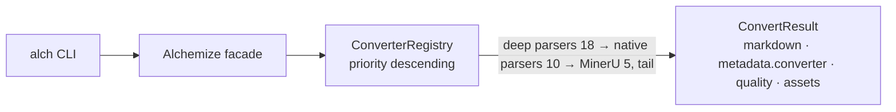

<div align="center">


[](https://www.rust-lang.org/) [](https://www.rust-lang.org/) [](LICENSE)

[中文](README.md) | **English**

**Transmute any document into Markdown**

[✨ Features](#-features) • [🚀 Quick Start](#-quick-start) • [📚 Documentation](#-documentation) • [💻 Examples](#-examples) • [🤝 Contributing](#-contributing)

</div>

---

<div align="center">

### 🎯 One Input, Any Format, Markdown Out

Hand `alch` a file — PDF, Office, audio/video, a zip archive — and it picks the engine via a priority fallback chain, producing Markdown with an honest quality label:

<table style="width:100%; border-collapse: collapse">
<tr>
<td align="center" width="25%">🧪<br><b>Any format</b><br><span style="color:#64748B">documents · code · images · audio/video · subtitles · zip</span></td>
<td align="center" width="25%">🔗<br><b>Fallback chain</b><br><span style="color:#64748B">priority-descending · automatic degradation · degradation is explicit</span></td>
<td align="center" width="25%">🏷️<br><b>Quality tiers</b><br><span style="color:#64748B">api / local_full / local_fallback · engine traceable</span></td>
<td align="center" width="25%">🏠<br><b>Local first</b><br><span style="color:#64748B">zero external services by default · fully offline with --no-remote</span></td>
</tr>
</table>

</div>

---

## 📋 Table of Contents

<details open>
<summary>📑 Table of Contents</summary>

- [✨ Features](#-features)
- [🚀 Quick Start](#-quick-start)
- [🎨 Feature Flags](#-feature-flags)
- [📚 Documentation](#-documentation)
- [💻 Examples](#-examples)
- [🏗️ Architecture](#️-architecture)
- [🧪 Testing](#-testing)
- [📊 Performance](#-performance)
- [🔒 Security](#-security)
- [🗺️ Roadmap](#️-roadmap)
- [🤝 Contributing](#-contributing)
- [📋 Changelog](#-changelog)
- [📄 License](#-license)
- [🙏 Acknowledgments](#-acknowledgments)
- [📞 Contact & Support](#-contact--support)
- [⭐ Star History](#-star-history)

</details>

---

## ✨ Features

<table style="width:100%; border-collapse: collapse">
<tr>
<td width="50%" style="vertical-align:top; padding: 12px">📄 <b>Full document formats</b><br><span style="color:#64748B">PDF (pdfium/pure-Rust/MinerU), docx/pptx, odt/odp, legacy binary Office (doc/ppt/rtf via LibreOffice), html/epub, csv/tsv/psv, LaTeX/org/rst/asciidoc (pandoc), ipynb</span></td>
<td width="50%" style="vertical-align:top; padding: 12px">🧬 <b>Code fencing</b><br><span style="color:#64748B">py/rs/js/ts/go/java/c/cpp/json/yaml/toml/xml/sh and ~45 extensions total, as language-tagged fenced code blocks</span></td>
</tr>
<tr>
<td width="50%" style="vertical-align:top; padding: 12px">🖼️ <b>Image handling</b><br><span style="color:#64748B">Inject a VisionProvider for description and OCR; without one, degrades to metadata-only markdown (dimensions/hash)</span></td>
<td width="50%" style="vertical-align:top; padding: 12px">🎙️ <b>Audio/video transcription</b><br><span style="color:#64748B">In-house vecboost facade (Qwen3-ASR ONNX + silero VAD), fully local inference; VAD-segmented text with timestamps</span></td>
</tr>
<tr>
<td width="50%" style="vertical-align:top; padding: 12px">⏱️ <b>Subtitle parsing</b><br><span style="color:#64748B">srt/vtt/ass/ssa parsed natively into timestamped segments, no ffmpeg involved</span></td>
<td width="50%" style="vertical-align:top; padding: 12px">📦 <b>Recursive zip</b><br><span style="color:#64748B">Archive members routed to their own engines by extension; nested zips are explicitly unsupported — unbounded self-recursion is structurally impossible</span></td>
</tr>
<tr>
<td width="50%" style="vertical-align:top; padding: 12px">🌐 <b>Multi-encoding detection</b><br><span style="color:#64748B">UTF-8 first → CJK-priority probing (GBK/Big5/Shift-JIS/…) → lossy fallback; CSV delimiter auto-detection</span></td>
<td width="50%" style="vertical-align:top; padding: 12px">🧭 <b>Engine preference & diagnostics</b><br><span style="color:#64748B"><code>--engine</code> prefix-matches and moves to front (silent fallback on miss); <code>doctor</code> per-engine availability, <code>formats</code> full list</span></td>
</tr>
<tr>
<td width="50%" style="vertical-align:top; padding: 12px">🖼 <b>Dual asset modes</b><br><span style="color:#64748B"><code>dir</code> (images written to <code>images/</code> with relative references) and <code>inline</code> (base64, single-file delivery)</span></td>
<td width="50%" style="vertical-align:top; padding: 12px">🛡️ <b>Security defenses</b><br><span style="color:#64748B">MinerU URL SSRF validation (HTTPS-only / private-range denial / hostname allowlist), tiered response limits, credentials redacted on all three output paths</span></td>
</tr>
<tr>
<td width="50%" style="vertical-align:top; padding: 12px">☁️ <b>MinerU cloud fidelity</b><br><span style="color:#64748B">Agent/Precision dual clients selected by file size, polling with backoff; local first, cloud as last resort (chain tail)</span></td>
<td width="50%" style="vertical-align:top; padding: 12px">🧰 <b>CLI diagnostics trio</b><br><span style="color:#64748B"><code>convert</code> (-o/--engine/--assets/--no-remote/--format), <code>doctor</code>, <code>formats</code>; semantic exit codes 0/1/2/3</span></td>
</tr>
</table>

Beyond these core capabilities, video track extraction and frame dedup, video processing modes (Gpu/AudioOnly/Disabled), a Whisper-compatible cloud backend (activated only via explicit injection), and LaTeX math-delimiter validation are all built in or provided behind independent feature flags; see the [🎨 Feature Flags](#-feature-flags) section for the full matrix.

---

## 🚀 Quick Start

### 📦 Installation

```bash
# Check the Rust version (1.97.1+ required)
rustc --version

# Default features (CLI + plain text only, zero external-service dependencies; breaking change — see "Feature Flags")
cargo build --release          # binary: target/release/alch

# Opt in per format (example: PDF + Word + HTML; enable only the features you need)
cargo build --release --features pdf,docx,html

# Full build (all 28 conversion features: MinerU cloud + self-hosted office deep parsers + containers/data/e-mail + LibreOffice + local ASR)
cargo build --release --features full

# Install locally
cargo install --path . --features full
# Note: with --no-default-features you must include `cli`, otherwise no `alch` binary is produced
```

### 💡 Minimal Example

```bash
# Convert to stdout (PDF requires building with --features pdf)
alch convert paper.pdf

# Write file + engine preference + asset mode (parent dirs auto-created; Word requires --features docx)
alch convert report.docx -o report.md --engine docx-deep --assets dir|inline

# stderr summary line: quality tier and actual engine at a glance
# converted report.docx -> report.md [local_full] (engine: docx-deep)
```

```bash
# Engine diagnostics / supported formats
alch doctor
alch formats
```

Exit codes: `0` success (including degraded output); `1` other errors; `2` unsupported format; `3` entire chain failed (stderr lists each engine's failure reason).

### 📊 Supported-format matrix

| Category | Extensions | Engine (priority) | Feature |
| --- | --- | --- | --- |
| Word (OOXML) | docx | docx-deep(18) → docx(10) | `docx` |
| Word (legacy) | doc, rtf | legacy-office(15, LibreOffice) | `legacy-office` |
| OpenDocument text | odt | odt-deep(18) | `odt` |
| Presentations | pptx / ppt,pps,pot / odp | pptx-deep(18) → pptx(10) / legacy-ppt(15) / odp-deep(18) | `pptx` / `odp` (`legacy-office` for legacy binaries) |
| Spreadsheets | — (not supported) | The spreadsheet parser was removed: calamine materialization (shared strings, styles/theme, ODS repeats and text expansion) cannot be bounded by a pre-check; xlsx/xls/xlsb/ods are unsupported | — |
| PDF | pdf | pdfium(20) → pdf-extract(10) → MinerU(5) | `pdf` / `pdf-local` / `pdf-cloud` |
| Web / e-book | html, htm / epub | html(htmd) → html-deep(15) / epub | `html` (base + deep chain) / `epub` |
| Plain text / code | txt, md, log, jsonl, ndjson, env, properties, rmd, qmd, mmd + ~45 code extensions | text (fenced) | `text` (default member) |
| Tabular text | csv, tsv, psv | csv (delimiter sensing) | `csv` |
| Markup languages | tex, latex / org, rst, adoc, asciidoc, opml, mediawiki, wiki, textile | latex-source / pandoc-generic | `latex` / `pandoc` |
| Notebooks | ipynb | ipynb | `ipynb` |
| Images | png, jpg, jpeg, gif, webp, bmp, tif, tiff, svg / heic, heif | image (optional Vision) / heic (sips or metadata) | `media` / `heic` |
| Audio | wav, mp3, ogg, opus, flac, aac, m4a, wma | audio (optional ASR) | `media` (+ `audio` for transcription) |
| Video | mp4, m4v, mov, avi, mkv, webm, flv, wmv | video (ffmpeg + optional ASR/Vision) | `media` (+ `audio` for transcription) |
| Subtitles | srt, vtt, ass, ssa, lrc | subtitle | `media` |
| E-mail | eml | eml | `email` |
| Structured data | parquet / sqlite, db, sqlite3 / bib | parquet / sqlite / bib | `parquet` / `sqlite` / `bibtex` |
| Archives | zip, cbz / tar, tgz / gz, xz, zst / 7z | zip recursion / tar family / 7z | `zip` / `tar`/`gzip`/`xz`/`zstd`/`sevenz` |

### 🧭 Core Concepts

- **Registry & fallback chain**: engines for an extension are tried in descending `priority()`; on failure the next engine takes over; `Unavailable` engines are skipped with the reason recorded.
- **Quality tiers**: every output is labeled `api` (cloud high-fidelity) / `local_full` (full local) / `local_fallback` (degraded local), recorded in `metadata` and the stderr summary line together with the actual engine name.
- **Local first**: the PDF chain is pdfium(20, `pdf-local` feature) → pdf-extract(10) → MinerU(5, chain tail once configured) — the cloud is only a fallback after the local chain fails.

---

## 🎨 Feature Flags

### 📦 Feature Presets

| Preset | Command | Use case |
| --- | --- | --- |
| Minimal (default) | `cargo build` | CLI + plain text / fenced code only (`default = ["cli", "text"]`); PDF/Office need explicit format features |
| Common documents | `cargo build --features pdf,docx,pptx,odt,odp,html,epub,csv,ipynb,zip` | Main document path + zip recursion; add more formats as needed |
| Full | `cargo build --features full` | All 28 conversion features (including MinerU cloud PDF, local ASR, containers/data/e-mail) |

### 📋 Feature Matrix

**Format family (15, one feature per format)**

| feature | Gates | Notes |
| --- | --- | --- |
| `text` | TextConverter | Plain text and ~45 code extensions with fenced code blocks; **default member** |
| `csv` | CsvConverter | csv/tsv/psv with delimiter sensing |
| `html` | HtmlConverter (htmd base chain) + HtmlDeepConverter (native deep chain) | Both HTML chains live in one feature; without `html`, html/htm conversion is unavailable |
| `pdf` | PdfConverter (lopdf text extraction) | Local fallback tier; pdfium high fidelity needs `pdf-local` |
| `docx` | DocxConverter + DocxDeepConverter | OOXML deep + basic parsing (quick-xml + zip) |
| `pptx` | PptxConverter + PptxDeepConverter | Same as above |
| `odt` | OdtConverter | Same as above |
| `odp` | OdpConverter | Same as above |
| `epub` | EpubConverter | rbook + zip + htmd |
| `ipynb` | IpynbConverter | Core serde_json only |
| `zip` | ZipConverter | One-level zip/cbz recursion (nested zip explicitly unsupported) |
| `latex` | LatexSourceConverter | pandoc probe + fenced fallback |
| `pandoc` | PandocGenericConverter | org/rst/asciidoc/opml/mediawiki and friends |
| `media` | image / audio / video / subtitle converters | Images, audio/video track extraction, subtitle parsing; transcription backend needs `audio` |
| `heic` | HeicConverter | sips or metadata fallback; standalone feature |

**Backends / data / containers / tool surface**

| feature | Pulls in | Notes |
| --- | --- | --- |
| `pdf-local` | local high-fidelity PDF engine (pdfium-render) | Implies `pdf`; probes the dynamic library at runtime, falls back to pdf-extract. Embedded images come from a lopdf structure walk (DCT/JPX passthrough, samples re-encoded to PNG, unsupported items counted explicitly) |
| `pdf-cloud` | MinerU cloud PDF engine (reqwest/limiteron) | registered only after the endpoint is configured via `ALCHEMIZE_MINERU_URL` |
| `audio` | vecboost transcription facade + Whisper-compatible API | Implies `media`; Qwen3-ASR ONNX + silero VAD, path dependency on sibling crate vecboost |
| `legacy-office` | legacy binary Office engine (external soffice) | doc/rtf→docx and ppt/pps/pot→pptx, then the deep chain; degrades when absent |
| `email` | e-mail engine (mail-parser) | headers / body / attachment list |
| `parquet`/`sqlite`/`bibtex` | structured data engines, split into three per-format features | streaming parquet with a 100k-row cap, read-only sqlite, biblatex entries |
| `tar`/`gzip`/`xz`/`zstd`/`sevenz` | archive family, split into five per-format features | recursive conversion, magic-byte detection of the inner format; `.tgz` needs both `tar` and `gzip` |
| `cli` | CLI skeleton (sdforge + inklog) | **default member**; `[[bin]] alch` has `required-features = ["cli"]` |
| `mcp` | MCP tool surface (`alch-mcp` stdio server) | convert/doctor/formats exposed as MCP tools; not part of default |
| `full` | All 28 conversion features (format family + backends/data/containers; excludes `cli`/`mcp`) | |

**Default behavior (breaking change)**: `default = ["cli", "text"]` — the default build compiles only the CLI skeleton and plain-text conversion. `alch convert x.pdf` / `x.docx` has no candidate engine in a default build and returns `unsupported format` (exit code 2). Enable the features you need explicitly (e.g. `--features pdf,docx`); `--features full` restores all capabilities.

**Dependencies**: apart from the 9 core crates (`serde`/`serde_json`/`thiserror`/`tracing`/`tokio`/`async-trait`/`anyhow`/`base64`/`sha2`), every dependency is `optional = true` and activated only through a feature's `dep:` reference; disabling a feature keeps its dependencies out of the build graph. Version upgrades: `base64 0.23`, `sha2 0.11`, `image 0.25`, `pdfium-render 0.9` (`pdfium_6295` bindings; runtime e2e awaits a newer pdfium binary), `zstd 0.14`, `icu_properties 2.4`; `rusqlite` stays at `0.39` (`0.41` hard-conflicts with `libsqlite3-sys <0.38` from limiteron→dbnexus→sqlx).

---

## 📚 Documentation

<details>
<summary>📋 Table</summary>

| Doc | Description |
|------|------|
| [📖 User Guide](docs/USER_GUIDE.md) | Complete tutorial from install to advanced use |
| [📘 API Reference](docs/API_REFERENCE.md) | All public APIs, CLI surface, environment variables |
| [🏗️ Architecture](docs/ARCHITECTURE.md) | Design principles, module layout, fallback-chain mechanics |
| [❓ FAQ](docs/FAQ.md) | Frequently asked questions |
| [🔒 Security](docs/SECURITY.md) | Trust boundaries, SSRF guards, vulnerability reporting |
| [🤝 Contributing](docs/CONTRIBUTING.md) | Dev environment, TDD workflow, commit conventions |
| [📋 Changelog](docs/CHANGELOG.md) | Release history |

</details>

Capability-domain spec sources (verifiable behaviors for conversion / fallback chains / media / CLI output) live in `specmark/specs/`.

---

## 💻 Examples

### 🤖 CLI Tool

```bash
# Pipe-friendly: straight to stdout
alch convert paper.pdf | head -50

# Batch: shell loop
for f in docs/*.docx; do alch convert "$f" -o "md/$(basename "${f%.docx}").md"; done

# Offline/compliance environments: zero network egress
alch convert --no-remote secret.docx -o secret.md

# Force the format when the extension is untrustworthy
alch convert payload.bin --format pdf
```

### 🦀 As a Library

```rust
use alchemize::{AlchemizeBuilder, Input};

#[tokio::main]
async fn main() -> Result<(), alchemize::AlchemizeError> {
    // Enable the matching format feature in your Cargo.toml (e.g. features = ["pdf"]); otherwise convert returns UnsupportedFormat
    let alch = AlchemizeBuilder::new().build();
    let result = alch.convert(&Input::Path("paper.pdf".into())).await?;
    println!("engine: {}", result.metadata["converter"]);   // actual engine
    println!("quality: {}", result.quality);                // quality tier
    println!("{}", result.markdown);
    Ok(())
}
```

More examples (custom vision/transcription providers, asset modes, registry assembly) in the [API Reference · Examples](docs/API_REFERENCE.md#-使用示例).

---

## 🏗️ Architecture

Single-crate DDD three layers: `domain` (types and rules, no network/process IO) → `application` (converter registry with a priority fallback chain + ports) → `infrastructure` (per-format converters + MinerU/ASR backends).



Design principles, module layout and data flows in the [🏗️ Architecture doc](docs/ARCHITECTURE.md).

---

## 🧪 Testing

### 🎯 Test Strategy

- **Three-tier matrix**: default tier (core + text only, no external services), `--features full` tier (all conversion capabilities) and `--all-features` tier (including cli/mcp), all fully run.
- **Real-file suite**: 12 real-file tests with hard assertions, using 9 in-repo fixtures and 1 external video source — not synthetic samples.
- **Golden outputs**: `tests/golden.rs` pins the textual shape of each format's output.
- **CLI e2e**: exit codes, stderr summaries, asset writing verified end to end.

### ▶️ Commands

```bash
cargo test                     # default tier (154 tests: core + text only)
cargo test --features full     # full tier (907 tests)
cargo test --all-features      # all-features tier (912 tests, including cli/mcp)
cargo clippy --all-features   # no new warnings
cargo fmt --check             # zero format diffs
cargo llvm-cov --features full # coverage (gate ≥90%)
```

### 📊 Test Scale

| Tier | Test cases | Scope |
| --- | --- | --- |
| default (cli+text) | 154 | core + text only |
| full | 907 | all conversion capabilities (5 ignored: real-model e2e etc.) |
| all-features | 912 | including cli/mcp (5 ignored: real-model e2e etc.) |

Line coverage **90.49%** (gate ≥90%).

---

## 📊 Performance

No criterion benchmarks yet — no performance numbers are provided (none are fabricated). Design-level trade-offs: single-threaded runtime, async remote paths (limiteron polling backoff), no global health cache (per-conversion probing), bounded response memory (tiered limits, 8MB preallocation cap). Design notes in [🏗️ Architecture · Performance](docs/ARCHITECTURE.md#-性能设计); benchmark data will be added once criterion is introduced.

---

## 🔒 Security

### 🛡️ Security Design

Four defense lines: structured error handling for untrusted input (no panics); SSRF validation of MinerU download URLs (HTTPS-only, loopback/RFC1918/CGNAT/link-local denied, hostname allowlist, presigned signatures); tiered response limits (64KB/8KB/50MB/50MB); credentials from env vars or `MineruConfig::api_token`, redacted on all three output paths. Details in the [🔒 Security doc](docs/SECURITY.md).

### ⛓️ Supply Chain and Gates

`Cargo.lock` is committed to lock the dependency graph; every source file carries an `SPDX-License-Identifier: Apache-2.0` header (59/59, machine-readable for license scanners); `cargo audit` is part of the upgrade flow, with known accepted risks registered in the [Security doc](docs/SECURITY.md#已知且可接受的风险).

### 🚨 Reporting Security Issues

**Do not** open a public issue. Use GitHub private security advisories (**Security → Report a vulnerability**); process and response commitments in the [Security doc · Reporting](docs/SECURITY.md#-漏洞报告流程).

---

## 🗺️ Roadmap

<details>
<summary>📋 Table</summary>

<table style="width:100%; border-collapse: collapse">
<tr><th style="text-align:center">Status</th><th style="text-align:left">Area</th><th style="text-align:left">Items</th></tr>
<tr><td align="center">✅</td><td>Conversion engines</td><td>registry fallback chain, full document formats, code fencing, recursive zip, multi-encoding detection</td></tr>
<tr><td align="center">✅</td><td>Optional backends</td><td>self-hosted office deep parsers (docx/odt/odp/pptx), MinerU cloud PDF (SSRF guards + limits), vecboost local ASR</td></tr>
<tr><td align="center">✅</td><td>Media pipelines</td><td>vision port, ffmpeg track extraction, native subtitle parsing, frame dedup, VAD-segmented transcription</td></tr>
<tr><td align="center">✅</td><td>CLI & diagnostics</td><td>sdforge-wrapped (CLI+MCP dual surface), convert/doctor/formats, semantic exit codes, engine preference & asset modes</td></tr>
<tr><td align="center">✅</td><td>Docs & compliance</td><td>seven-doc suite (structure aligned with confers), bilingual README, SPDX headers 59/59, coverage 90.49%</td></tr>
<tr><td align="center">✅</td><td>Supply chain</td><td>anydoc dependency removed, zip is 9.4.1 only; cargo audit vulnerabilities at zero (unmaintained notices remain)</td></tr>
<tr><td align="center">🔲</td><td>Release</td><td>first crates.io publish (vecboost first) + crates.io/docs.rs badges</td></tr>
<tr><td align="center">🔲</td><td>CI & quality</td><td>GitHub Actions three-tier matrix + codecov coverage badge</td></tr>
<tr><td align="center">🔲</td><td>Performance</td><td>criterion benchmarks → real data for a PERFORMANCE doc</td></tr>
<tr><td align="center">🔲</td><td>ASR real pipeline</td><td>run the real-model e2e once the model bundle is available (currently #[ignore])</td></tr>
</table>

</details>

---

## 🤝 Contributing

### 🛠️ Development Environment

Rust 1.91+, one command to get started: `cargo build --features full` (requires sibling crate vecboost). See [🤝 Contributing](docs/CONTRIBUTING.md).

### 💖 Ways to Contribute

- New format engine: implement the `Converter` trait + wire it in `engines.rs` + behavior-pinning tests
- Bug fixes: write the failing test first, then fix (TDD)
- Docs & specs: docs follow the confers skeleton; behavior changes update `specmark/specs/` in the same batch

### 🐛 Report Bugs

Open a [GitHub Issue](https://github.com/Kirky-X/alchemize/issues) with a minimal reproduction file (sanitized), `alch --version`, and expected vs. actual output.

### 💡 Feature Suggestions

Open an issue labeled `enhancement`; proposals touching network egress or credential handling should read the [Security doc](docs/SECURITY.md) first.

### 🔧 Submit a PR

Conventional Commits (feat/fix/test/docs/chore); local gates before submitting: `cargo fmt --check` + `cargo clippy --all-features` with no new warnings + both test tiers green.

---

## 📋 Changelog

See [docs/CHANGELOG.md](docs/CHANGELOG.md).

---

## 📄 License

Apache-2.0 ([LICENSE](LICENSE)). Every source file carries an SPDX header; files migrated from other repositories keep their original copyright year ranges.

---

## 🙏 Acknowledgments

### 🌟 Core Dependencies

- [pdf-extract](https://github.com/jrmuizel/pdf-extract) (MIT) — PDF text-layer extraction.
- [quick-xml](https://github.com/tafia/quick-xml) (MIT/Apache-2.0) — OOXML/ODF/OMML event streams.
- [sevenz-rust2](https://github.com/hasenbanck/sevenz-rust2) (Apache-2.0) plus [tar](https://github.com/alexcrichton/tar-rs)/[flate2](https://github.com/rust-lang/flate2)/[xz2](https://github.com/alexcrichton/xz2-rs)/[zstd](https://github.com/gyscos/zstd-rs) (MIT/Apache-2.0) — archive containers.
- [parquet](https://github.com/apache/arrow-rs) (Apache-2.0), [rusqlite](https://github.com/rusqlite/rusqlite) (MIT), [biblatex](https://github.com/typst/biblatex) (MIT) — structured data engines.
- [mail-parser](https://github.com/stalwartlabs/mail-parser) (Apache-2.0/MIT) — EML parsing.
- [LibreOffice](https://www.libreoffice.org/) (MPL-2.0) — legacy binary Office conversion (optional external tool).
- [pandoc](https://pandoc.org/) (GPL-2.0+) — LaTeX/org/rst/asciidoc markup conversion (optional external tool).
- [vecboost](https://github.com/Kirky-X/vecboost) (own project) — Qwen3-ASR ONNX + silero VAD local transcription facade.
- Excellent open-source crates: [pdf-extract](https://crates.io/crates/pdf-extract), [quick-xml](https://crates.io/crates/quick-xml), [aspasia](https://crates.io/crates/aspasia), [rbook](https://crates.io/crates/rbook), [htmd](https://crates.io/crates/htmd), and more.

### 💝 Special Thanks

- [PDFMathTranslate](https://github.com/PDFMathTranslate/PDFMathTranslate) (AGPL-3.0) — design ideas absorbed only (layout region classification, image-page OCR fallback, paragraph reassembly); zero code copied; alchemize remains Apache-2.0.
- mnemis (own project, not public) — source of the migrated converter skeleton.
- [confers](https://github.com/Kirky-X/confers) — the reference baseline for documentation style and engineering conventions.

---

## 📞 Contact & Support

<table style="width:100%; max-width: 600px">
<tr>
<td align="center" width="33%">
<a href="https://github.com/Kirky-X/alchemize/issues"><b style="color:#991B1B">Issues</b></a><br>
<span style="color:#64748B">Report bugs and problems</span>
</td>
<td align="center" width="33%">
<a href="https://github.com/Kirky-X/alchemize/security/advisories"><b style="color:#1E40AF">Security Advisories</b></a><br>
<span style="color:#64748B">Private vulnerability reports</span>
</td>
<td align="center" width="33%">
<a href="https://github.com/Kirky-X/alchemize"><b style="color:#1E293B">GitHub</b></a><br>
<span style="color:#64748B">Browse the source</span>
</td>
</tr>
</table>

---

## ⭐ Star History

[](https://star-history.com/#Kirky-X/alchemize&Date)

If this project helps you, please consider giving it a ⭐️!
