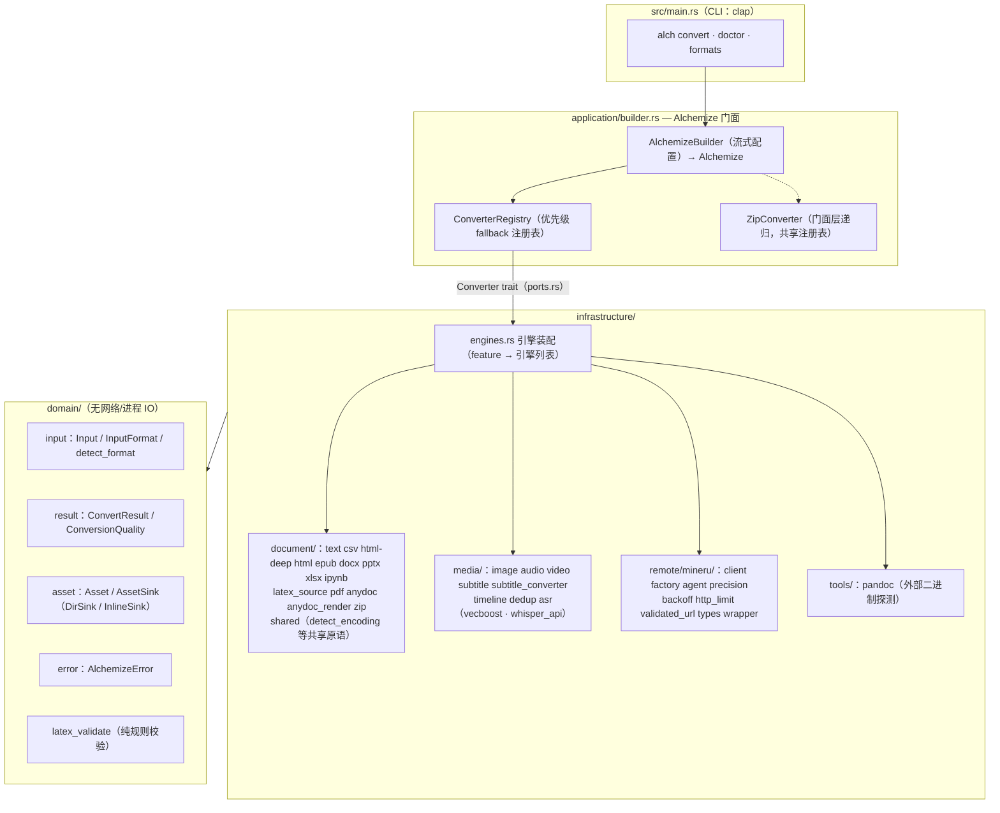
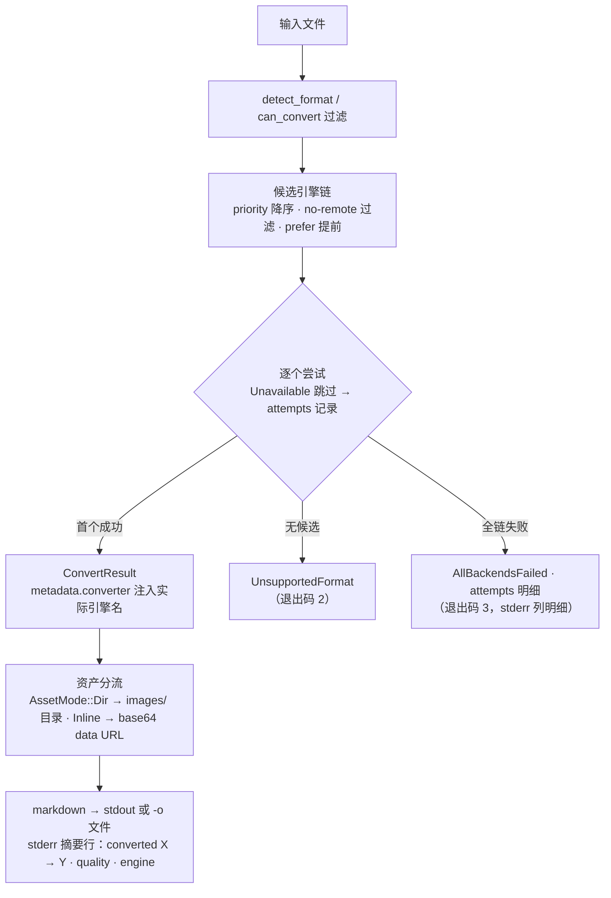

# 🏗️ Alchemize 架构文档

Alchemize 是一个把任意文档炼成 Markdown 的 Rust 工具（CLI `alch` + 同名库），采用单 crate DDD 三层架构：`domain` 承载类型与规则（无网络/进程 IO），`application` 承载端口与优先级 fallback 注册表，`infrastructure` 承载各格式转换器与远端后端。本文档基于 `src/` 实际代码结构，介绍设计原则、模块划分、数据流以及安全与性能设计。

## 📋 目录

- [概述](#-概述)
- [设计原则](#-设计原则)
- [系统架构](#️-系统架构)
- [模块划分](#-模块划分)
- [数据流](#-数据流)
- [安全设计](#-安全设计)
- [性能设计](#-性能设计)
- [相关文档](#-相关文档)

## 🎯 概述

Alchemize 的目标是「一处输入，任意格式，产出 Markdown」。它内置一张按优先级组织的转换器注册表：同一扩展名的多个引擎按 `priority()` 降序形成 fallback 链，前序失败自动落到次优，`Unavailable` 的引擎跳过并记录原因；每个产出都如实标注质量层级（`api` / `local_full` / `local_fallback`）与实际引擎名。

三个入口共享同一套核心：

- **CLI `alch`**：`convert`（单文件转换）/ `doctor`（逐引擎可用性诊断）/ `formats`（支持扩展名清单）。
- **库 API**：`AlchemizeBuilder` 流式配置 → `Alchemize` 门面（`convert` / `convert_pref`）。
- **扩展点**：实现 `Converter` / `VisionProvider` / `TranscribeProvider` 端口即可注入自定义引擎。

## 📐 设计原则

1. **domain 无网络/进程 IO**：`src/domain/` 不发网络请求、不起子进程；文件读写仅有两处边界内例外——`Input::to_bytes` 读盘、`DirSink` 落盘（资产写出）。其余领域逻辑可脱离环境测试。
2. **端口-适配器分离**：`application/ports.rs` 定义 `Converter` / `VisionProvider` / `TranscribeProvider` / `ExternalTool` 四个 trait，基础设施层实现它们；注册表只依赖 trait，不依赖具体引擎。
3. **降级显性化**：引擎不可用（`Availability::Unavailable`）直接跳过并记录原因，不静默重试；全链失败返回 `AllBackendsFailed { ext, attempts }` 携带逐引擎失败明细。
4. **本地优先**：云端引擎（MinerU）优先级低于本地链，仅在本地链失败后尝试；`--no-remote` 可整体排除云端引擎。
5. **结果可观测**：成功结果在 `metadata.converter` 记录实际引擎名，`quality` 字段如实标注来源层级，禁止低优结果冒充高质量。

## 🏛️ 系统架构

## 🧩 模块划分

### 公开核心模块（无特性门控）

| 模块 | 职责 |
| --- | --- |
| `domain/input.rs` | `Input`（`Path` / `Bytes{data, filename, mimetype, extension}` 两种载体）、`InputFormat` 枚举、`detect_format()`（魔数嗅探优先、扩展名映射兜底） |
| `domain/result.rs` | `ConvertResult`（markdown + metadata + content_type + quality + title + assets）、`ConversionQuality`、`ContentType`、`VideoProcessingMode` |
| `domain/asset.rs` | `Asset{filename, bytes, role}` 与 `AssetSink`（`DirSink` 写 `images/`、`InlineSink` 转 base64 data URL）——DirSink 落盘是 domain 层唯一写盘点 |
| `domain/error.rs` | `AlchemizeError` 15 个变体与 `SecurityViolationType` |
| `domain/latex_validate.rs` | LaTeX 数学定界符纯规则校验（无 IO） |
| `application/ports.rs` | 四个端口 trait + `Availability` + `Transcript`（VAD 段级转录，明确不含说话人归属）+ `which_program()` PATH 探测 |
| `application/registry.rs` | 优先级降序注册、fallback 链尝试、attempts 记录、`metadata.converter` 注入 |
| `application/builder.rs` | `AlchemizeBuilder` → `Alchemize` 门面（convert / convert_pref / availability / engines / asset_sink_for）；zip 门面特判 |
| `infrastructure/document/` | text（纯文本 + ~45 扩展名代码围栏）、csv（分隔符自探测）、html-deep（自研迭代状态机 → htmd 兜底，feature `html-deep`）、html、epub、docx/pptx/xlsx（原生 XML）、latex-source（pandoc 探测 + 围栏兜底）、pdf（lopdf + TOC 剔除/结构启发）、anydoc_render（自研 GFM 渲染器）、shared（detect_encoding：UTF-8 → CJK 优先探测 → lossy 兜底） |
| `infrastructure/media/` | image / audio / video（ffmpeg 抽轨）/ subtitle（srt/vtt/ass/ssa 原生解析）/ timeline / dedup（视频帧去重） |
| `infrastructure/remote/mineru/` | 云端 PDF 后端（见[特性门控模块](#特性门控模块)） |
| `infrastructure/tools/` | pandoc 外部二进制探测（构建时缺席、运行时探测） |

### 特性门控模块

| feature | 模块 | 说明 |
| --- | --- | --- |
| `anydoc` | `infrastructure/document/anydoc.rs` | office 全格式后端（firecrawl/anydoc, MIT），含旧版二进制 Office（doc/ppt/…）；priority 15 压过原生解析；图片按文档序经自研 `anydoc_render` 渲染 |
| `mineru` | `infrastructure/remote/mineru/` | 云端 PDF：`client`/`factory`（按文件大小选 agent/precision 客户端）、`backoff`（limiteron 轮询退避）、`http_limit`（响应体积分级上限）、`validated_url`（SSRF 校验）、`wrapper`（Converter 适配，priority 5 链尾） |
| `asr` | `infrastructure/media/asr/` | `vecboost.rs`（自研 transcribe 门面：Qwen3-ASR ONNX 三件套 + silero VAD，path 依赖兄弟仓）与 `whisper_api.rs`（Whisper 兼容云端后端，仅显式注入激活） |
| `html-deep` | `infrastructure/document/html_deep/` | 自研迭代状态机（HTML→Markdown）+ htmd 兜底，priority 15 压过 html(10)；`--extract-main`/`--base-url` |

feature 关闭的引擎根本不出现在 `engines.rs` 装配列表中；`mineru` 还需配置端点（`ALCHEMIZE_MINERU_URL` 或库 API `with_mineru`）才注册。

### crate 组织

alchemize 为**单 crate**（`[package]` + `[lib]` + `[[bin]] alch`），无 workspace 子成员、无子 crate。与兄弟仓的关系是 path 依赖：`vecboost`（feature `asr` 下）——发布顺序约束为 vecboost 先于 alchemize 发到 crates.io。

## 🌊 数据流

### 转换主流程

失败终态两条：无候选 → `UnsupportedFormat`（退出码 2）；全链失败 → `AllBackendsFailed{ext, attempts}`（退出码 3，stderr 列明细）。

### 降级链数据流

以 PDF 为例（feature `anydoc` 开、MinerU 已配置时）：

| 顺序 | 引擎 | priority | quality |
| --- | --- | --- | --- |
| 1 | `anydoc` | 15 | `local_full` |
| 2 | `pdf`（pdf-extract + TOC 剔除/结构启发） | 10 | `local_fallback` |
| 3 | `mineru`（云端，仅在本地链失败后尝试） | 5 | `api` |

前序引擎返回 `Err` 自动尝试次优；`Unavailable` 引擎直接跳过（原因记入 attempts）；`--engine NAME` 把名称匹配（精确或前缀，大小写不敏感）的引擎提到队首，未命中静默回落。`quality` 由产出引擎如实标注，与尝试顺序解耦。

### zip 递归容器数据流

zip 在门面层特判处理：`ZipConverter` 与主注册表共享同一引擎集（`Arc<ConverterRegistry>` clone），压缩包内普通文件按扩展名走各自引擎；zip 自身**不注册进注册表**，嵌套 zip 直接报不支持——无界自递归在结构上不可能发生。

## 🔒 安全设计

四道防线（完整模型见[安全文档](SECURITY.md)）：

1. **输入不可信**：文档输入按不可信构造处理，ZIP 容器（docx/pptx/xlsx/epub/zip）经声明式依赖解析，解析失败返回结构化错误而非 panic。
2. **SSRF 防护**：MinerU 文件下载 URL 必须通过 `ValidatedFileUrl` 校验（HTTPS-only、拒环回/私网/CGNAT/链路本地、IPv4 映射 IPv6 同分类、域名白名单、签名要求）。
3. **响应限量**：远端响应按用途分级上限（64KB/8KB/50MB/50MB，预分配 8MB），超限返回 `ResponseTooLarge`。
4. **凭据脱敏**：`MineruConfig::api_token` 在 `Debug`/`Display`/serde 三通路全部脱敏（手工 `Debug` impl + 单测钉住）；凭据只经环境变量传递。

## ⚡ 性能设计

设计级取舍（本仓暂无 criterion 基准数据，不提供性能数字）：

- **单线程 runtime**：CLI 用 current-thread tokio runtime（`main.rs`），转换以单文件为粒度，无跨任务共享状态竞争。
- **async-trait 端口**：远端与转录路径全异步，轮询退避经 limiteron `delay_for_attempt`，不忙等。
- **无全局健康缓存**：availability 每次转换即时探测（单次转换内一致），换取无过期窗错误路由。
- **内存有界**：远端响应经分级限量读取器（预分配上限 8MB）；zip 拒绝嵌套递归防无界深度。
- **降级而非失败**：本地链先行省去云端往返；依赖缺失（视觉/转录）降级为元数据 markdown，不阻塞整链。

## 📚 相关文档

- [📘 API 参考](API_REFERENCE.md) — 全部公开 API、CLI 接口与环境变量
- [📖 用户指南](USER_GUIDE.md) — 从安装到进阶的完整使用教程
- [❓ FAQ](FAQ.md) — 常见问题解答
- [🔒 安全文档](SECURITY.md) — 信任边界、SSRF 防护、漏洞报告
- [🤝 贡献指南](CONTRIBUTING.md) — 开发环境、测试与提交约定
- [📋 更新日志](CHANGELOG.md) — 版本变更记录
- 能力域规格真源：`specmark/specs/`（fallback-chain / document-conversion / media-conversion / cli-output / domain-ports / docs-suite / license-headers）
