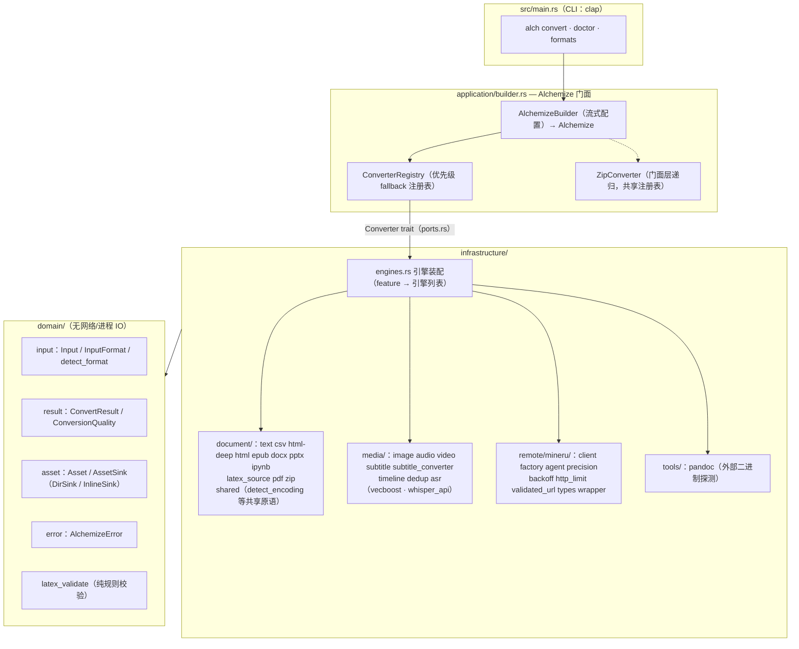
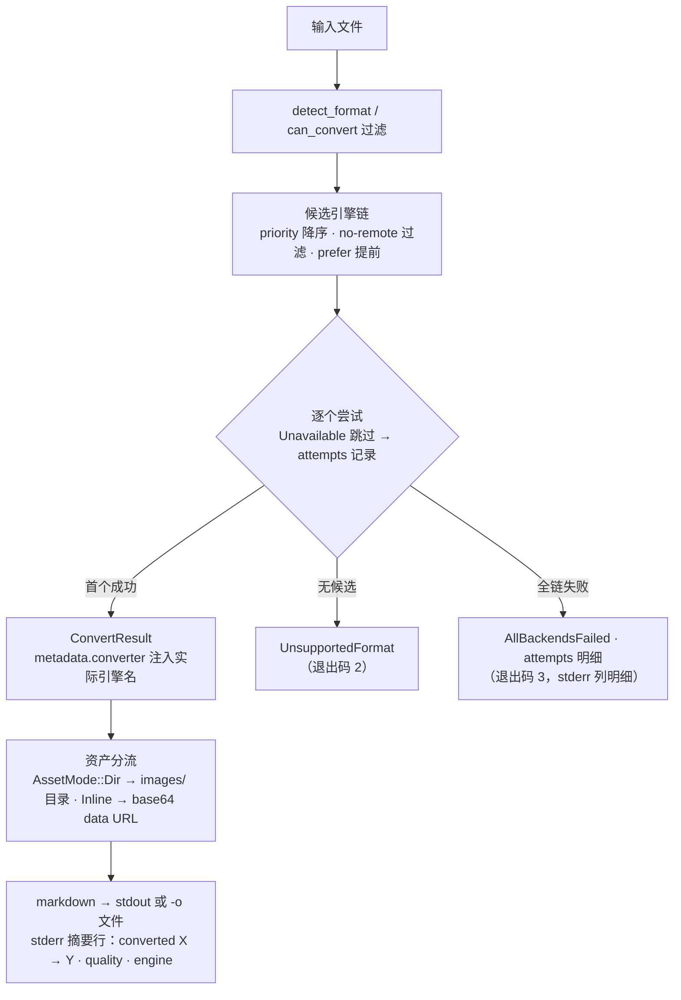

# 🏗️ Alchemize Architecture

Alchemize is a Rust tool that transmutes any document into Markdown (the `alch` CLI plus the library of the same name), built as a single-crate DDD three-layer architecture: `domain` carries types and rules (no network/process IO), `application` carries ports and the priority fallback registry, and `infrastructure` carries the per-format converters and remote backends. Based on the actual code layout in `src/`, this document covers the design principles, module layout, data flows, and the security and performance design.

## 📋 Table of Contents

- [Overview](#-overview)
- [Design Principles](#-design-principles)
- [System Architecture](#️-system-architecture)
- [Module Layout](#-module-layout)
- [Data Flows](#-data-flows)
- [Security Design](#-security-design)
- [Performance Design](#-performance-design)
- [Related Documents](#-related-documents)

## 🎯 Overview

Alchemize's goal is "one input, any format, Markdown out". It ships a converter registry organized by priority: multiple engines for the same extension form a fallback chain in descending `priority()` order; when an earlier engine fails, the next-best takes over automatically; `Unavailable` engines are skipped with the reason recorded; every output is labeled honestly with its quality tier (`api` / `local_full` / `local_fallback`) and the actual engine name.

Three entry points share the same core:

- **CLI `alch`**: `convert` (single-file conversion) / `doctor` (per-engine availability diagnostics) / `formats` (the supported-extension list).
- **Library API**: `AlchemizeBuilder` chained configuration → the `Alchemize` facade (`convert` / `convert_pref`).
- **Extension points**: implement the `Converter` / `VisionProvider` / `TranscribeProvider` ports to inject custom engines.

## 📐 Design Principles

1. **domain has no network/process IO**: `src/domain/` makes no network requests and spawns no subprocesses; file IO has exactly two in-boundary exceptions — `Input::to_bytes` reads from disk and `DirSink` writes assets out. Everything else in the domain layer is testable without an environment.
2. **Port-adapter separation**: `application/ports.rs` defines the four traits `Converter` / `VisionProvider` / `TranscribeProvider` / `ExternalTool`, implemented by the infrastructure layer; the registry depends only on traits, never on concrete engines.
3. **Degradation is explicit**: an unavailable engine (`Availability::Unavailable`) is skipped outright with the reason recorded — no silent retries; a full-chain failure returns `AllBackendsFailed { ext, attempts }` carrying per-engine failure details.
4. **Local first**: the cloud engine (MinerU) has lower priority than the local chain and is tried only after the local chain fails; `--no-remote` excludes cloud engines entirely.
5. **Observable results**: successful results record the actual engine name in `metadata.converter`, and the `quality` field labels the source tier honestly — low-tier results are forbidden from masquerading as high quality.

## 🏛️ System Architecture

## 🧩 Module Layout

### Public Core Modules (not feature-gated)

| Module | Responsibility |
| --- | --- |
| `domain/feature_map.rs` | The extension→capability-feature mapping table (single source of truth), the compile-time enabled-feature list, and the missing-feature data surface (the CLI hint is assembled by `forge_app`) |
| `domain/input.rs` | `Input` (the two carriers `Path` / `Bytes{data, filename, mimetype, extension}`), the `InputFormat` enum, `detect_format()` (magic-byte sniffing first, extension mapping as fallback) |
| `domain/result.rs` | `ConvertResult` (markdown + metadata + content_type + quality + title + assets), `ConversionQuality`, `ContentType`, `VideoProcessingMode` |
| `domain/asset.rs` | `Asset{filename, bytes, role}` and `AssetSink` (`DirSink` writes `images/`, `InlineSink` produces base64 data URLs) — DirSink's disk write is the only write point in the domain layer |
| `domain/error.rs` | The 15 `AlchemizeError` variants and `SecurityViolationType` |
| `domain/latex_validate.rs` | Pure-rule validation of LaTeX math delimiters (no IO) |
| `application/ports.rs` | The four port traits + `Availability` + `Transcript` (VAD-segmented transcription, explicitly not speaker attribution) + `which_program()` PATH probing |
| `application/registry.rs` | Priority-descending registration, fallback-chain attempts, attempts recording, `metadata.converter` injection |
| `application/builder.rs` | The `AlchemizeBuilder` → `Alchemize` facade (convert / convert_pref / availability / engines / asset_sink_for); the zip facade special case |
| `infrastructure/document/{gfm_render,shared}` | The in-house GFM renderer; shared primitives (`shared::detect_encoding` gated separately by `any(text,csv,pandoc,media)`); the module itself has no external dependencies and stays unconditional |

### Feature-Gated Modules

Format modules are gated by their matching format feature; the `office` aggregate module's gate is `any(docx, pptx, odt, odp, legacy-office)`.

| feature | Module | Notes |
| --- | --- | --- |
| `text` | `infrastructure/document/text.rs` | Plain text + ~45-extension code fencing (default member) |
| `csv` | `infrastructure/document/csv.rs` | Delimiter auto-detection |
| `html` | `infrastructure/document/html.rs` + `html_deep.rs` | htmd base chain + native deep chain (priority 15 outranking html(10)); `--extract-main`/`--base-url` |
| `pdf` | `infrastructure/document/pdf.rs` | lopdf fallback-tier text extraction + TOC removal/structure heuristics |
| `docx`/`pptx`/`odt`/`odp` | `infrastructure/document/office/` | OOXML/ODF deep and basic parsing (module gate `any(docx,pptx,odt,odp,legacy-office)`) |
| `epub` | `infrastructure/document/epub.rs` | rbook + zip + htmd |
| `ipynb` | `infrastructure/document/ipynb.rs` | Notebook cells to markdown |
| `zip` | `infrastructure/document/zip.rs` (wired at the facade layer) | Recursive zip/cbz container |
| `latex`/`pandoc` | `document/latex_source.rs`, `document/pandoc_generic.rs`, `tools/pandoc.rs` (module gate `any(latex,pandoc)`) | External pandoc probing + fenced fallback; generic markup languages |
| `media` | `infrastructure/media/` (image/audio/video/subtitle/timeline/dedup) | Images, ffmpeg track extraction, native subtitle parsing, frame dedup |
| `heic` | `infrastructure/media/heic.rs` | sips or metadata fallback (standalone feature) |
| `pdf-local` | `infrastructure/document/pdfium.rs`, `pdf_images.rs` | pdfium high fidelity (implies `pdf`) + embedded-image extraction |
| `pdf-cloud` | `infrastructure/remote/mineru/` | Cloud PDF: `client`/`factory` (agent/precision client selected by file size), `backoff` (limiteron polling backoff), `http_limit` (tiered response size caps), `validated_url` (SSRF validation), `wrapper` (Converter adapter, priority 5 chain tail) |
| `audio` | `infrastructure/media/asr/` | `vecboost.rs` (the in-house transcribe facade: the Qwen3-ASR ONNX trio + silero VAD; the registry depends on vecboost) and `whisper_api.rs` (Whisper-compatible cloud backend, activated only via explicit injection) |
| `legacy-office` | `document/office/legacy_office.rs`, `tools/libreoffice.rs` | Legacy binary Office (external soffice) |
| `tar`/`gzip`/`xz`/`zstd`/`sevenz` | `infrastructure/containers/` | The container family; RegistrySlot weak-reference backfill |
| `parquet`/`sqlite`/`bibtex` | `infrastructure/data/` | parquet / sqlite / biblatex |
| `email` | `infrastructure/document/eml.rs` | E-mail (mail-parser) |

Engines whose feature is off never appear in the `engines.rs` assembly list at all (each registration statement in `engines.rs` and the converter definition share the same feature gate); `mineru` additionally needs a configured endpoint (`ALCHEMIZE_MINERU_URL` or the library API `with_mineru`) to register. The default is `["cli", "text"]`, so the default build has only the text converter.

### Crate Organization

alchemize is a **single crate** (`[package]` + `[lib]` + `[[bin]] alch`), with no workspace members and no sub-crates. The relationship with the sibling repo vecboost is a registry dependency (under feature `audio`, `vecboost = "0.3"`), with no sibling-directory requirement.

## 🌊 Data Flows

### Main Conversion Flow

Two failure terminal states: no candidates → `UnsupportedFormat` (exit code 2); full-chain failure → `AllBackendsFailed{ext, attempts}` (exit code 3, details on stderr).

### Fallback-Chain Data Flow

Taking PDF as an example (MinerU configured):

| Order | Engine | priority | quality |
| --- | --- | --- | --- |
| 1 | `pdf` (pdf-extract + TOC removal/structure heuristics) | 10 | `local_fallback` |
| 2 | `mineru` (cloud, tried only after the local chain fails) | 5 | `api` |

When an earlier engine returns `Err`, the next-best is tried automatically; `Unavailable` engines are skipped outright (the reason recorded in attempts); `--engine NAME` prefers the exact name, falls back to prefix matching when there is no exact hit (case-insensitive), moves the matched engine to the front, and silently falls back on a miss. `quality` is labeled honestly by the producing engine, decoupled from attempt order.

### Recursive zip Container Data Flow

zip is special-cased at the facade layer: `ZipConverter` shares the same engine set as the main registry (an `Arc<ConverterRegistry>` clone), and plain files inside the archive are routed by extension to their own engines; zip itself is **not registered in the registry**, and nested zips report unsupported directly — unbounded self-recursion is structurally impossible.

tar/tgz/gz/xz/zst/7z go through the container converters inside the registry: they need the same assembled registry to convert inner files, so at construction they receive only a weak-reference slot (`RegistrySlot`), backfilled by `AlchemizeBuilder::build` once the registry is wrapped in an `Arc` — a strong reference would form an Arc cycle. Nesting depth is counted per "conversion chain" with a tokio task-local (concurrent conversions do not interfere), and inner entries beyond `MAX_DEPTH=3` degrade to attachments. If a caller-built registry never backfills the slot, entries degrade to attachments and `metadata.registry_wired=false` is recorded — the whole archive never fails. The zip facade has its own 1 GiB aggregate decompression cap, separate from the container depth layer (nested zips are explicitly unsupported).

## 🔒 Security Design

Four defense lines (the full model in the [Security doc](SECURITY.md)):

1. **Untrusted input**: document input is treated as an untrusted construct; ZIP containers (docx/pptx/epub/zip) are parsed with declarative dependency resolution, and parse failures return structured errors instead of panicking.
2. **SSRF protection**: MinerU file download URLs must pass `ValidatedFileUrl` validation (HTTPS-only, loopback/private-range/CGNAT/link-local denial, IPv4-mapped IPv6 classified the same, hostname allowlist, signature requirement).
3. **Response limits**: remote responses have tiered per-purpose caps (64KB/8KB/50MB/50MB, 8MB preallocation); over-limit returns `ResponseTooLarge`.
4. **Credential redaction**: `MineruConfig::api_token` is redacted on all three paths (`Debug`/`Display`/serde, hand-written `Debug` impl + unit-test pinning); credentials come from environment variables or `MineruConfig::api_token` and are sent only to endpoints that pass `validate_base_url`.

## ⚡ Performance Design

Design-level trade-offs (this repo has no criterion benchmark data and provides no performance numbers):

- **Multi-threaded runtime**: `alch` (`main.rs` explicitly builds a multi-thread runtime; the `alch mcp` subcommand shares the same process) is multi-threaded (the MCP wrapper's internal `block_in_place` requires it); conversion is granular to a single file with no cross-task shared-state contention.
- **async-trait ports**: remote and transcription paths are fully async; polling backoff goes through limiteron's `delay_for_attempt` — no busy waiting.
- **No global health cache**: availability is probed per conversion (consistent within a single conversion), trading for zero stale-window misrouting.
- **Bounded memory**: remote responses go through a tiered limited reader (8MB preallocation cap); zip rejects nested recursion to prevent unbounded depth.
- **Degrade, don't fail**: the local chain going first saves the cloud round trip; missing dependencies (vision/transcription) degrade to metadata markdown without blocking the chain.

## 📚 Related Documents

- [📘 API Reference](API_REFERENCE.md) — all public APIs, the CLI surface, and environment variables
- [📖 User Guide](USER_GUIDE.md) — the complete tutorial from installation to advanced use
- [❓ FAQ](FAQ.md) — frequently asked questions
- [🔒 Security](SECURITY.md) — trust boundaries, SSRF guards, vulnerability reporting
- [🤝 Contributing](CONTRIBUTING.md) — dev environment, testing, and commit conventions
- [📋 Changelog](CHANGELOG.md) — release history
- Capability-domain spec sources: `specmark/specs/` (fallback-chain / document-conversion / media-conversion / cli-output / domain-ports / docs-suite / license-headers)
